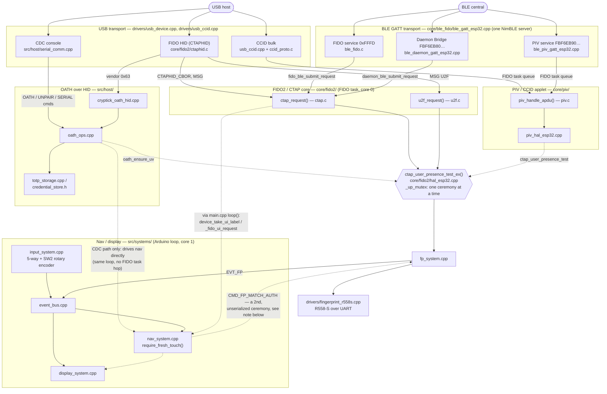

# Architecture — Cryptick Token (ESP32-S3 PCB v0.1.0)

Software layers, threading model, and the firmware-wide event bus. For the
hardware/USB-descriptor/boot-sequence view (what gets initialized, in what
order, and why), see **[PROJECT.md](../PROJECT.md)**. For the full wire
protocols of the two BLE-adjacent and PIV subsystems sketched below, see
**[BLE_FIDO.md](BLE_FIDO.md)** and **[MAC_LOGIN.md](MAC_LOGIN.md)** — this
page cross-references them rather than repeating their detail.

## Subsystem map

Every box below is a real file or module; every arrow is a real call or
queue hand-off, not an aspirational one. `core/fido2/ctap_request()` has
exactly one caller — the FIDO FreeRTOS task on core 0 — and USB, BLE-FIDO,
the BLE daemon bridge, and (via `piv_handle_apdu()`) USB-CCID and BLE-PIV are
all **producers** into that one consumer, never second consumers of their
own. See [Threading model](#threading-model) below for why that matters.



**The one gap this diagram makes visible:** `nav_system`'s on-device menu
ceremony (enroll, clear-FP, BLE-unpair — `require_fresh_touch()`) and the
HAL's `ctap_user_presence_test_ex()` ceremony are two *different* mechanisms
driving the same single `fp_system` sensor singleton, and nothing serializes
them against each other the way `_up_mutex` serializes concurrent
`ctap_user_presence_test_ex()` callers. A CDC `OATH PUT` self-service wait
(blocks the main loop, polls the sensor directly) could in principle overlap
a menu ceremony the user triggered a loop iteration earlier, misattributing
one touch to the other. This is a known, narrow, pre-existing race — not
fixed here — flagged for whoever owns `fp_system`/`nav_system` next.

## Layers (quick reference)

```text
USB host ── CDC console ── src/host/serial_comm
         └── HID ──┬── core/fido2        (CTAP2 / U2F)
                   └── src/host/cryptick_oath_hid  (OATH APDUs)
                        └── src/host/oath_ops ── src/host/totp_storage ── LittleFS

R558-S UART ── drivers/fingerprint_r558s ── src/systems/fp_system
5-way + encoder GPIO ── input_system ── event_bus ── nav_system ── display_system
BQ25185 STAT ── battery_system ──────────────────────────  display_system
DS3231 I2C  ── set_synced_utc ── soft clock (+ RTC if present) ── core/totp
```

This is the same OATH/TOTP/UI slice as the diagram above, in plain text. For
PIV/CCID and BLE, see the subsystem map above — this shorthand predates both.

Charge **FULL** is `CHARGE_DONE`: STAT1/STAT2 both high (BQ25185 "charge done") *and* VIN still present. This PCB has no VBUS GPIO, so USB mount stands in for VIN — otherwise HIGH/HIGH is indistinguishable from unplugged sleep, which is why the old 10 s sticky never showed FULL when you plugged in an already-full cell. Unplug clears it back to the idle half-bar.

Dependencies point downward only. `drivers/` never includes `src/`, and `core/`
never includes `src/` — the FIDO stack reaches the application exclusively
through the HAL surface declared in `core/fido2/device.h`.

## Threading model

Two cores run application code, and nearly every past concurrency bug came from
forgetting which is which.

| Context | Core | Owns |
| --- | --- | --- |
| Arduino `loop()` | 1 | All systems: input, nav, display, fp, battery, serial console |
| FIDO task | 0 | `core/fido2` CTAP processing, OATH-over-HID handlers |
| TinyUSB task | — | HID OUT report callback (`_onOutput`) |

Rules that follow from this:

- **Only the Arduino loop may call `nav_system_*` or `display_system_*`.** The
  FIDO task hands UI captions over with `device_set_ui_label()`; the loop drains
  them with `device_take_ui_label()`. Use `device_on_fido_task()` when a shared
  helper needs to branch on the caller.
- **Anything both cores touch needs a lock.** The current set:

| Shared state | Guard | Where |
| --- | --- | --- |
| `credentials` vector | recursive mutex | `src/host/credential_store.h` |
| CDC log sink | mutex | `core/cryptick_log.cpp` |
| Event bus ring indices | spinlock | `src/systems/event_bus.cpp` |
| HID RX ring indices | spinlock | `drivers/usb_device.cpp` |
| HID IN submission | mutex | `drivers/usb_device.cpp` |
| I2C bus (OLED + RTC) | mutex | `i2c_lock()` / `i2c_unlock()` |
| User-presence ceremony | mutex (try-take) | `core/fido2/hal_esp32.cpp` |

  `volatile` alone is **not** sufficient for a multi-field ring buffer: it
  prevents caching but not interleaving. Prefer `portENTER_CRITICAL` for the
  short index updates and a FreeRTOS mutex where the section can block.

- **Only one user-presence ceremony may be in flight.** `_user_confirmed` is a
  single global that every `ctap_user_presence_test_ex()` caller polls, and both
  cores can reach it: the FIDO task during a WebAuthn ceremony, and the Arduino
  loop during a CDC `OATH PUT` / `TOTP_DEL` (`oath_ensure_uv`). Unserialized,
  one fingerprint touch returned success to **both** — the user approves the
  prompt on the OLED and silently authorises the other operation. The ceremony
  mutex is taken with a zero timeout, so a second ceremony is refused (returns
  `0`, the caller reports a UV failure) rather than parked behind a 29s finger
  wait. Any future transport must feed this same gate rather than adding a
  second presence flag. This mutex does **not** cover `nav_system`'s own
  on-device menu ceremony (`require_fresh_touch()`) — see the gap called out
  under [Subsystem map](#subsystem-map) above.

- The `credentials` lock is recursive because the OATH handlers hold it across
  helpers in `oath_ops` that lock again. Use the `CredentialLock` RAII guard so
  an early return cannot leak it.

## Time

`get_synced_utc()` returns a soft base plus `millis()`, seeded from the DS3231
when present and otherwise from a lab epoch. `set_synced_utc(ts)` and
`device_set_time_utc()` apply immediately: they move the soft base, call
`settimeofday()`, and `rtc.adjust()` when the RTC is fitted (so the value
survives a reboot). CDC `SETTIME` / `DATE`, OATH `SET_TIME`, and HID `SET_TIME`
all funnel through that one path. There is deliberately no WiFi time sync.

## Event bus

Single-producer-agnostic ring of 48 entries carrying `EVT_INPUT`, `EVT_FP`,
`EVT_BATTERY`, `EVT_AUTH`, `EVT_UI_STATE`, and `EVT_CMD`. It is the only
sanctioned path for cross-system messages.

Ownership is strict: only `input_system` reads button GPIOs, and only
`display_system` draws to the OLED. A full bus drops the newest event rather
than blocking a publisher.

## UI states and idle sleep

`nav_system` owns the `UiState` machine and publishes every change as
`EVT_UI_STATE`; `display_system` renders whatever state it reads back. The enum
in `event_bus.h` is append-only because its numeric value appears in `[NAV]`
logs.

Boot draws a ~900 ms opening animation (`display_system_boot_animation()`, budget
in `BOOT_ANIM_MS`) built from U8g2 primitives rather than a bitmap, so it costs no
flash for assets. The retry path that recovers a missing panel never animates.

### Sleep is a UI state, not an SoC state

After `UI_SLEEP_TIMEOUT_SEC` of inactivity nav enters `UI_SLEEP`:

- `display_system` calls `u8g2.setPowerSave(1)` and then does no work at all —
  no redraws and no I2C rescans, which is the point.
- The fingerprint matcher is stopped and the unlock session is cleared, so a
  token that goes dark in a pocket is also locked.
- **The MCU and USB stay up.** This is a security key; a host must still be able
  to reach it for FIDO while the screen is off. `esp_light_sleep_start()` would
  drop the USB connection mid-session, which is why it is not used here. There
  is no `esp_sleep` call anywhere in the tree.

Two things wake it:

| Trigger | Path |
| --- | --- |
| CENTER press | `nav_system_on_event()` — the press is consumed by the wake so a pocket press cannot open the menu |
| Host presence request | `nav_system_set_fido_ui(req != 0)` → `nav_system_wake()`, otherwise "Place finger" would be invisible |

`sleep_allowed()` holds the screen on for every state that is waiting on a human
or on the host (auth prompt, enroll, FIDO prompt/processing/success), for
`CRYPTICK_FIDO_CEREMONY_HOLD_MS` after a FIDO presence request (so idle sleep
cannot blank the token between Chrome's GetTouch U2F_REGISTER and the follow-up
CTAP2 MakeCredential), and while `fp_system_match_active()` — a host OATH UV
wait runs the matcher without owning a UI state.

The timeout is runtime-configurable and persisted in NVS (`cryptick` / `sleepsec`):
Settings → Sleep on the device, console `SLEEP <sec|NOW|OFF>` / `WAKE`, or the
Device Settings tab of `docs/index.html`. It is deliberately separate from
`INACTIVITY_TIMEOUT_SEC` in `auth_system` — that one guards access to codes, this
one guards power.

## Secrets at rest

`core/secret_crypto` wraps each TOTP secret with AES-256-GCM under a 32-byte key
held in NVS. A wrapped blob is `version(1) || nonce(12) || ciphertext || tag(16)`,
base64-encoded into the LittleFS JSON. `SECRET_CRYPTO_PT_MAX` bounds the
plaintext and `SECRET_CRYPTO_B64_MAX` is derived from it, so the two can never
drift apart. Details and the remaining gaps are in
[SECURITY_ROADMAP.md](SECURITY_ROADMAP.md).

## USB (no BOOT pads on this PCB)

1. **Product default:** TinyUSB with `ARDUINO_USB_MODE=0` → CDC + FIDO HID,
   VID `0x1209` PID `0xBEEE`.
2. Reflashing the app, in order of convenience:
   - PlatformIO/esptool **1200 bps touch** on the product CDC → ROM USB download
   - Console `BOOTLOADER` → `usb_persist_restart(RESTART_BOOTLOADER)`
   - HID `CTAPHID_ENTERBOOT` → same path
3. **Lab fallback** `esp32-s3-n16r8-jtag`: USB Serial/JTAG only (VID `303A`), logs
   but no FIDO HID. `ARDUINO_USB_MODE=1` must be paired with
   `ARDUINO_USB_CDC_ON_BOOT=1` so `Serial` resolves to the JTAG CDC class rather
   than UART0.
4. Product upload always finishes with `--after=hard_reset`.

## Fingerprint

Enrollment uses the module's non-blocking AutoEnroll (`0x31`); `fp_system` drains
status frames only while `_enrolling` is set, so the main loop never stalls on a
long blocking enroll. Matching runs `GenImg`/`Search` **only** while a TOTP unlock,
FIDO presence request, or enroll is active — the sensor is quiet at idle.

UART orientation (RX/TX swap) is auto-detected at boot.

## Build

`platformio.ini` keeps the shared include roots and USB identity flags in a
`[cryptick]` section that every environment interpolates, so a new include path
is added once. Unity suites extend `[test_base]` and append to the inherited
`build_src_filter` rather than re-listing the console backend.

New source files must be added to `build_src_filter` or they are silently
skipped.
